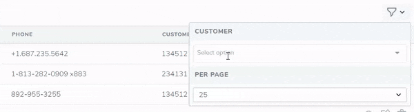

# Installation

```bash
composer require dukstra/nova-multiselect-filter
```

This fork targets PHP 8.3+, Laravel 13, and Laravel Nova 5.

# Description

Multiselect filter for Laravel Nova. Based on [vue-multiselect](https://vue-multiselect.js.org)



# Usage

```php
use Illuminate\Contracts\Database\Eloquent\Builder;
use Laravel\Nova\Http\Requests\NovaRequest;
use Klepak\NovaMultiselectFilter\NovaMultiselectFilter;

class CustomFilter extends NovaMultiselectFilter
{
    public function apply(NovaRequest $request, Builder $query, mixed $value): Builder
    {
        return $query->whereIn('field', $value);
    }

    public function options(NovaRequest $request)
    {
        return [
            'Label 1' => 'value-1',
            'Label 2' => 'value-2',
            'Label 3' => 'value-3',
        ];
    }
}
```

The filter's `apply` method must return an Eloquent builder, as required by
Nova 5. The `options` method continues to return the label-to-value choices
used by the multiselect.

# Testing
```shell script
composer test
```
